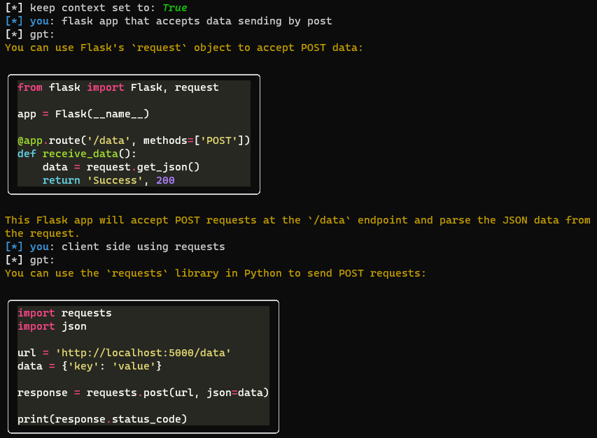
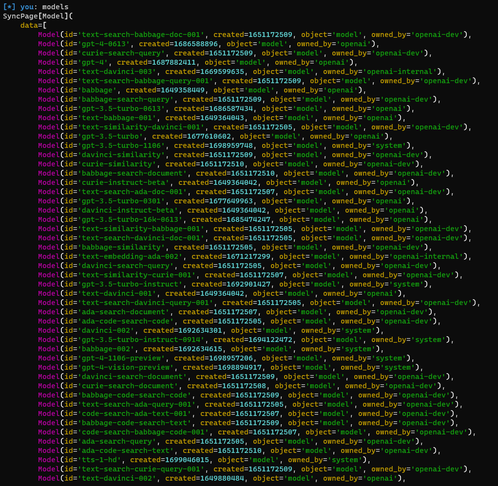
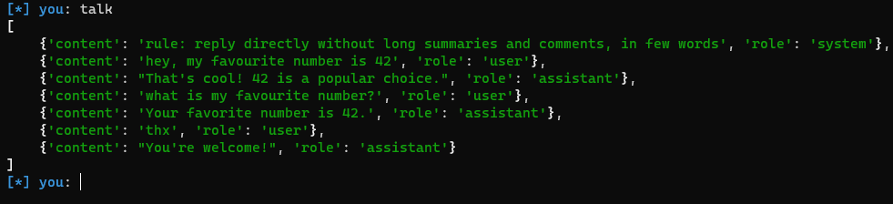

# chat

commandline chat gpt over api. To use it create .env file with `OPENAI-API-KEY` field in `chat.py` directory, e.g.:
```
OPENAI-API-KEY=sk-RULLPGZvOOWY8n5mvQ0qxh1o7hjuL1wgpEsjYlpLY8n5mvQb
```

## install shortcut (linux only)

```bash
make install
```

## screenshots

### code generation


### openai models


### context handling


## changelog

### 0.1.1

- bugfix: escaped rich brackets for inline replies
- enchance: `make install` creates desktop shortcut for Linux. <a href="https://www.flaticon.com/free-icons/chat-box" title="chat box icons">Chat box icons created by Ilham Fitrotul Hayat - Flaticon</a>
- enchance: model name shown in console (model prompt)
- enchance: context status shown in console (user prompt)

### ~0.1.0

- initial release with core functionality (not mentioned as version)
